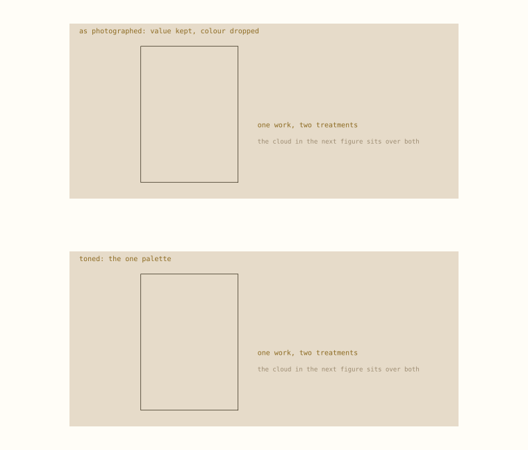
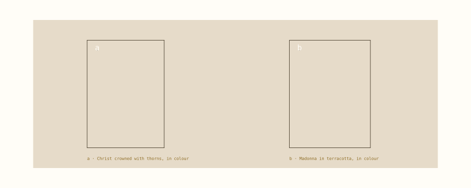
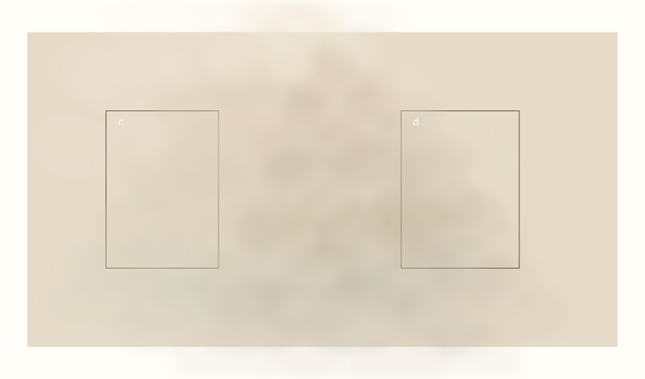
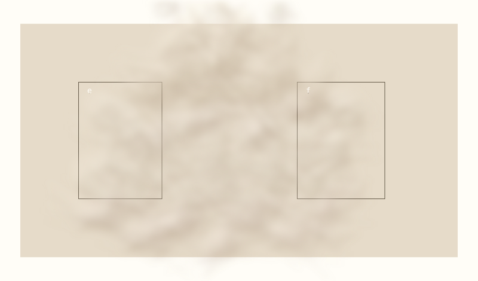
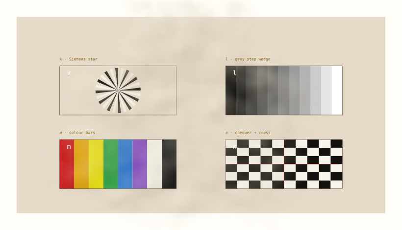
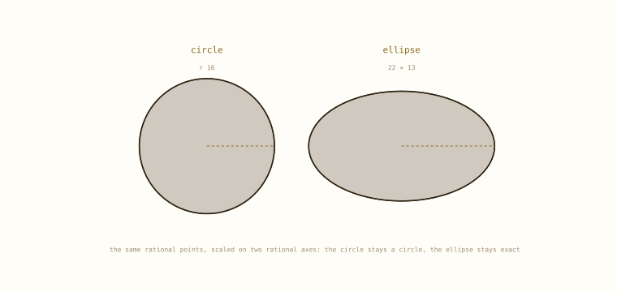
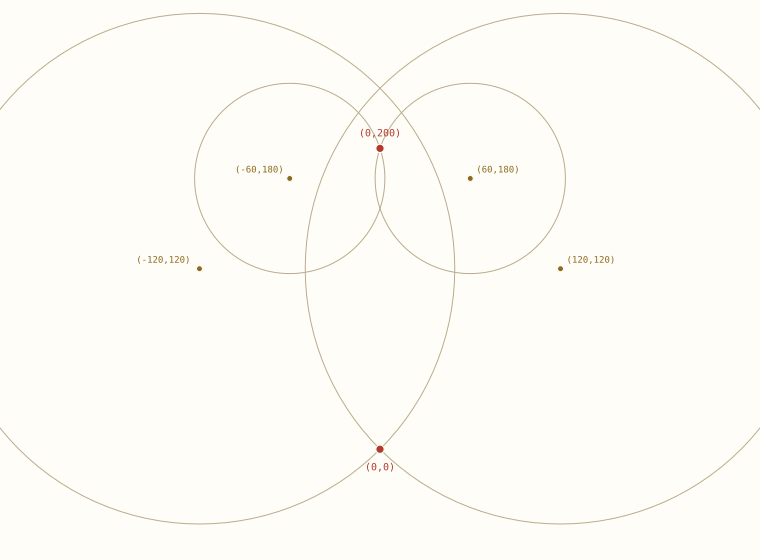
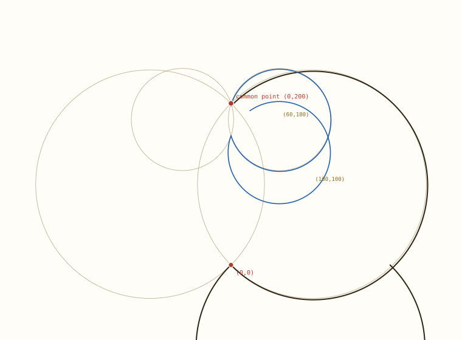

# A cloud, for veiling

The cathedral has no single artwork problem; it has one per piece. The proposal is a veil rather than a repair: tone the photographs into one palette of light tans and grays, and put a layered, semi-transparent cloud in front. The cloud is the constant; the works stay different behind it.

> The cloud is also a theological choice. At the Transfiguration, at the baptism, at the temple when Gabriel spoke, at Fatima, the cloud does not explain the action -- it shelters it. What is hidden stays God's to reveal.

| role | tone | use |
| --- | --- | --- |
| wall | #e6dbc9 | the constant ground |
| haze | #ded8cf | outer breath, alpha 0.06 |
| bank | #cfc9bf | the flat base, alpha 0.05 |
| billow | #ddd0bb | volume, alpha 0.18 |
| crown | #f2ead9 | lit tops, alpha 0.25 |
| shadow | #b7ad9d | under the mass, never black |


## 1. Tone first, then veil



*Fig. 1 · One photograph: value kept, colour dropped, then mapped onto the palette.*

Tone is the first half of the unification and the cloud is the second. The photograph here is one of the author's own, reduced to luminance and mapped onto the ramp above; the value structure stays, the colour argument goes. Two works of different periods then sit in the same room before the cloud is even drawn. The cloud hides the remaining seams -- the edges, the varnish, the reproduction -- rather than the subjects.

This is deliberately unheroic: no restoration, no repainting, no claim that the works match. They do not, and the veil says so honestly by being visible.


## 2. The veil



*Fig. 2 · a and b: the two works in colour, before any veil.*

Two versions, same composition, different geometry. **v1** is the original cloud of exact ellipses -- the one that was right in principle and only too opaque -- now with the veil factor on every layer instead of the base alone. **v2** replaces each ellipse with a turn-chain ribbon. Both are measured by the same function and judged by the same strips.



*Fig. 3 · c and d: v1, the original ellipse cloud, one veil factor on every layer.*



*Fig. 4 · e and f: v2, the same composition in turn-chain ribbons.*

The cloud is built from **exact turn chains**, not circles. A billow is a lobe whose turns run k**p and then reverse, so the exit is parallel to the entry; a taper through `ribbon.outline` turns it into a closed rational polygon with pointed ends. The power dial is the layer: p = 1 is the clothoid, p = 2 and 3 hold the turn back to the apsis and curl the tail. So each billow can be placed, repeated and stored without a float deciding its edge. What is not exact is the compositing: tone and transparency are design numbers, not geometry.

```text
layers   4   haze 0.1, bank 0.09, billow 0.3, crown 0.42
billows  306  turn-chain ribbons: turns k**p, tapered
edge     fractal displacement + gaussian blur, optical only
veil     v1 0.403 (peak 85%), v2 0.594 (peak 85%)
overlap  the sum does the softening
geometry exact; opacity and tone are choices
```

Two variants are worth keeping. A **cumulus** (above) has a flat base and a domed top. An **incense** cloud is taller, thinner and more transparent, with vertical drift; it is the better veil for a side chapel or a shrine, where the cloud should rise in front of the work rather than rest above it. Both are the same palette and the same ellipses -- only the layout and the opacities differ.


## 2b. Against four test patterns

A veil is judged by what it leaves legible. Four standard patterns -- a Siemens star, an eleven-step grey wedge, colour bars and a chequer with a crosshair -- sit under the same billows as the works: two on top, where the cloud is densest and meets the top of the image, two below, where it drifts. Each is sampled on a grid and the composited alpha is reported as mean, 95th percentile and worst. Both versions are solved to the same peak, 80 per cent -- the number chosen on the slider below -- so the comparison is about where the density lands, not how strong it is. The gate reads the row mean, because the mean is how much of the image is covered: top mean under 0.25 (a hot corner is allowed up to 0.50), bottom mean under 0.12 (up to 0.30).


*Fig. 5 · g to j: v1 under the four patterns, two on top, two below.*



*Fig. 6 · k to n: v2 under the four patterns.*

| version | pattern | row | mean | p95 | worst |
| --- | --- | --- | --- | --- | --- |
| v1 | Siemens star | top left | 0.464 | 0.742 | 0.794 |
| v1 | grey step wedge | top right | 0.306 | 0.740 | 0.826 |
| v1 | colour bars | bottom left | 0.443 | 0.632 | 0.698 |
| v1 | chequer + cross | bottom right | 0.324 | 0.614 | 0.722 |
| v2 | Siemens star | top left | 0.309 | 0.626 | 0.720 |
| v2 | grey step wedge | top right | 0.213 | 0.559 | 0.686 |
| v2 | colour bars | bottom left | 0.317 | 0.500 | 0.601 |
| v2 | chequer + cross | bottom right | 0.171 | 0.442 | 0.526 |

The numbers come from `pythagorean_spiral.veil`, the same function the drawing fills, so a strip cannot pass on paper while the picture covers it. `scripts/veil_test.py` writes the standalone page and `tests/test_veil.py` holds the gate.


## 2c. Set the transparency by eye (o to r)

The model should not be the authority on a design number. This strip is one uniform layer of one cloud colour over the same four patterns; drag the slider until the top row is as legible as you want it and the bottom as light as you want it. The percentage is the target the veil should then be solved to. Below, o to r each carry their own control: the design question is per picture, not per page.

<div class="veillab">
<style>
.veillab { margin: 22px 0 10px; }
.veillab .grid { display: grid; grid-template-columns: 1fr 1fr; gap: 14px; }
.veillab .card { margin: 0; border: 1px solid #d8ccae; background: #fffdf7; padding: 8px; }
.veillab .pic { position: relative; height: 220px; background: #e6dbc9 center/cover no-repeat; }
.veillab .layer { position: absolute; inset: 0; background: #ddd0bb; }
.veillab .tag { position: absolute; left: 6px; top: 6px; width: 20px; height: 20px;
  border-radius: 50%; background: #2e2413; color: #fffdf7; font: 11px/20px Georgia, serif;
  text-align: center; }
.veillab figcaption { font: 11px ui-monospace, Menlo, monospace; color: #7b6c4e;
  padding: 6px 0 2px; }
.veillab .ctl { display: grid; grid-template-columns: auto 1fr auto; gap: 8px;
  align-items: center; font: 11px ui-monospace, Menlo, monospace; color: #7b6c4e; }
.veillab input[type=range] { width: 100%; accent-color: #8c6a21; }
.veillab output { font-size: 13px; color: #2e2413; min-width: 40px; text-align: right; }
.veillab .bar { display: flex; gap: 10px; align-items: center; margin-top: 14px;
  flex-wrap: wrap; }
.veillab .bar button { font: 12px ui-monospace, Menlo, monospace; padding: 7px 14px;
  border: 1px solid #8c6a21; background: #f6f1e4; color: #2e2413; cursor: pointer; }
.veillab .bar button:hover { background: #efe6d2; }
.veillab .bar span { font: 11px ui-monospace, Menlo, monospace; color: #7b6c4e; }
</style>
<div class="grid"><figure class="card" data-name="o"><div class="pic" style="background-image:url('fig/cloud-colour-statue.png')"><div class="layer" data-layer style="opacity:0.85"></div><span class="tag">o</span></div><figcaption>o · statue, colour</figcaption><label class="ctl"><span>veil opacity</span><input type="range" min="0" max="100" step="1" value="85" data-slider aria-label="veil opacity for statue, colour"><output data-read>85%</output></label></figure><figure class="card" data-name="p"><div class="pic" style="background-image:url('fig/cloud-colour-fresco.png')"><div class="layer" data-layer style="opacity:0.85"></div><span class="tag">p</span></div><figcaption>p · fresco, colour</figcaption><label class="ctl"><span>veil opacity</span><input type="range" min="0" max="100" step="1" value="85" data-slider aria-label="veil opacity for fresco, colour"><output data-read>85%</output></label></figure><figure class="card" data-name="q"><div class="pic" style="background-image:url('fig/cloud-photo-statue.png')"><div class="layer" data-layer style="opacity:0.85"></div><span class="tag">q</span></div><figcaption>q · statue, toned</figcaption><label class="ctl"><span>veil opacity</span><input type="range" min="0" max="100" step="1" value="85" data-slider aria-label="veil opacity for statue, toned"><output data-read>85%</output></label></figure><figure class="card" data-name="r"><div class="pic" style="background-image:url('fig/cloud-photo-fresco.png')"><div class="layer" data-layer style="opacity:0.85"></div><span class="tag">r</span></div><figcaption>r · fresco, toned</figcaption><label class="ctl"><span>veil opacity</span><input type="range" min="0" max="100" step="1" value="85" data-slider aria-label="veil opacity for fresco, toned"><output data-read>85%</output></label></figure></div>
<div class="bar">
  <button type="button" id="save-json">save settings (json)</button>
  <button type="button" id="save-png">save o (png)</button>
  <span>the band that read best was 80-90 per cent</span>
</div>
<script>
(function () {
  var cards = Array.prototype.slice.call(document.querySelectorAll('.veillab .card'));
  function sync(card) {
    var v = card.querySelector('[data-slider]').value / 100;
    card.querySelector('[data-layer]').style.opacity = v;
    card.querySelector('[data-read]').textContent = Math.round(v * 100) + '%';
  }
  cards.forEach(function (card) {
    card.querySelector('[data-slider]').addEventListener('input', function () { sync(card); });
    sync(card);
  });
  function settings() {
    var out = {};
    cards.forEach(function (c) { out[c.dataset.name] = c.querySelector('[data-slider]').value / 100; });
    return out;
  }
  function download(name, blob) {
    var a = document.createElement('a');
    a.href = URL.createObjectURL(blob); a.download = name;
    document.body.appendChild(a); a.click(); a.remove();
  }
  document.getElementById('save-json').addEventListener('click', function () {
    download('veil-settings-chosen.json',
             new Blob([JSON.stringify(settings(), null, 1)], {type: 'application/json'}));
  });
  document.getElementById('save-png').addEventListener('click', function () {
    var card = cards[0], pic = card.querySelector('.pic');
    var img = new Image();
    img.onload = function () {
      var cv = document.createElement('canvas');
      cv.width = img.naturalWidth; cv.height = img.naturalHeight;
      var g = cv.getContext('2d');
      g.drawImage(img, 0, 0, cv.width, cv.height);
      g.globalAlpha = card.querySelector('[data-slider]').value / 100;
      g.fillStyle = '#ddd0bb';
      g.fillRect(0, 0, cv.width, cv.height);
      cv.toBlob(function (b) { download('veil-o.png', b); });
    };
    img.src = pic.style.backgroundImage.slice(5, -2);
  });
})();
</script>
</div>

## 3. Circles, ellipses, parabolas, hyperbolas



*Fig. 7 · A circle and the same circle scaled: both exact, and the rays remain rational under the scale.*

Not all four are the same curve, and it matters which is which. The chain is built from whole triangle angles, so its exact members are the circle (constant turn), the straight line (zero turn), the quarter-turn corner, and the clothoid-like family where curvature grows linearly. A circle is exact. An ellipse is exact **as an affine image of a circle** -- scale x by one rational and y by another, and every point stays rational -- but it is not a Euclidean circle and its curvature is not a clothoid. A parabola and a hyperbola have no such rational affine origin here, and no linear-curvature parameterisation; they can only be approximated, to the lattice's resolution, and the error should be measured rather than assumed.

The constructive part is real: because the ellipse is a scaled circle, a circle with rays from its diameter scales into an ellipse with rays, exactly. That is how the second drawing was made -- same points, same rational slopes, one rational scale. For a sunburst, a rose-window basis, or a billow with ribs, that is enough. For a true parabola or hyperbola, use the float path and report the gap.


## 4. The clothoid-like cloud, in four arcs

The simplest form is not a mass of puffs but four arcs: two big ones under the cloud, turning upward and meeting at (0,0); two half-size ones on top, turning downward and meeting near (0,200). Plotted with the stated centres, the form does not close -- the bottom circles are centred at (120,120) and (-120,120) with radius 169.7, the top at (60,180) and (-60,180) with radius 63.2, and the right-hand pair is nested by 21.6, so there is no side joint.



*Fig. 8 · The four arcs as stated, with centres and the two meeting points.*

Moving the bottom centres in to (100,100) fixes it more neatly than a side crossing would: the bottom radius becomes 141.4, which is also the distance to (0,200), so the bottom pair passes through both (0,0) and (0,200) -- and the top pair already passes through (0,200). That is the common point, and the cloud closes there. Two numbers remain: the big lobes reach x = 241 (about twice the intended width), and the tangent at (0,200) is G0, not G1, so the next tune is one centre and one tangent.



*Fig. 9 · Bottom centres at (100,100): all four arcs meet at (0,200).*


## 5. What this is not

This framework does not replace the clothoid engine, and it is not a subset of its curves. Bertolazzi gives real clothoids -- exact Fresnel geometry, many parameterisations, tolerances. The chain here is an Euler polygon whose *headings* match a clothoid at the nodes; its position is up to a chord away, and its curvature is a staircase. What it adds is the other column: rational points, rational slopes, exact joins and mirrors, and a known lattice. The caps in `out/caps` came from the engine and transfer here by quantising each chord's turn, with a measured gap. The honest architecture is: engine for the transcendental curve, chain for the exact plan, and a converter between them.


## Reproduce

```text
cd pythagorean-spiral
../.venv/bin/python scripts/cloud.py
../.venv/bin/python -m unittest discover -s tests -t .
```
