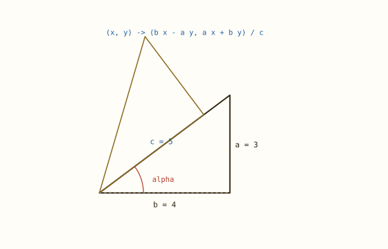
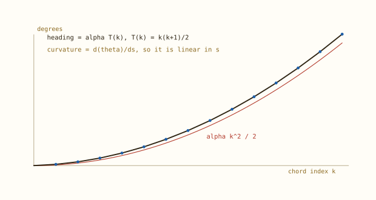
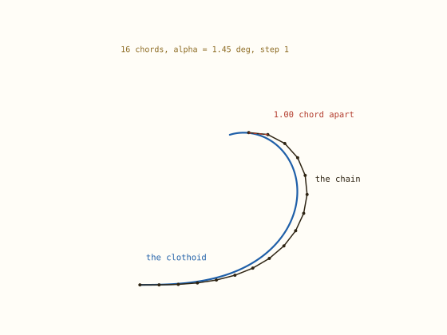
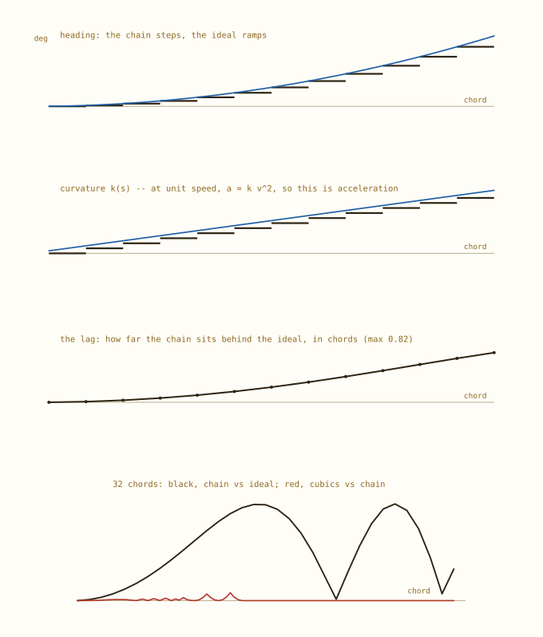
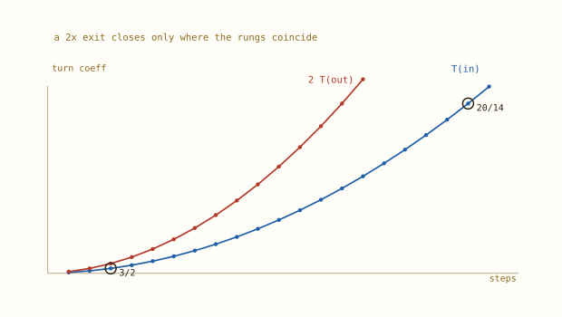
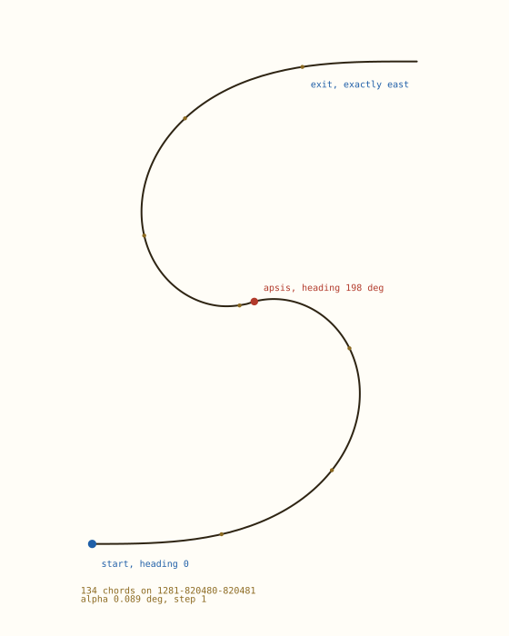
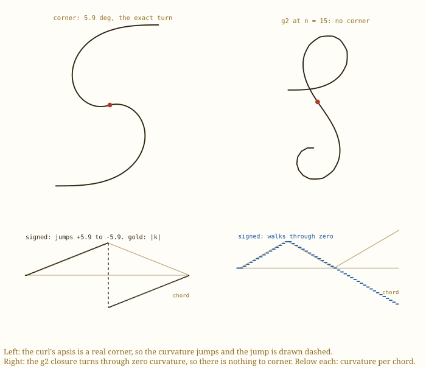
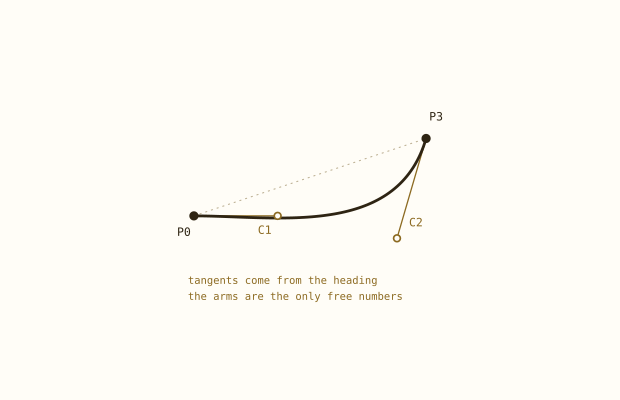
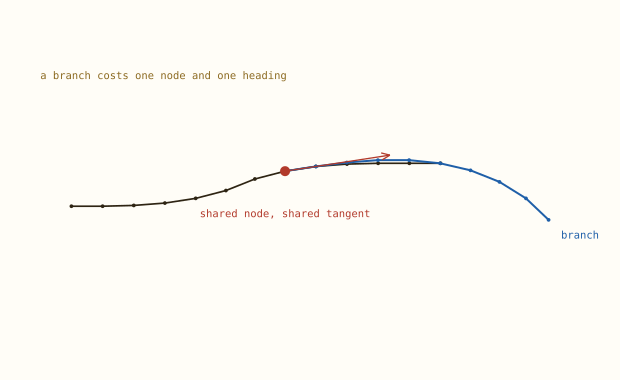

# The Pythagorean spiral

Smooth curves that connect to each other and branch from each other. A chain of equal chords, each turned by a whole number of right-triangle angles, carried in exact rational arithmetic, and drawn as cubic Béziers.

This is the spine layer in `pythagorean-spiral/`: central to the curve work, though not yet wired into `clothoid_lab/`. Its curve is an imitation of a clothoid rather than a clothoid. Everything below is either measured by the code beside it or proved, and the claims that did not survive are in `docs/AUDIT.md`.


## 1. One idea

A Pythagorean triangle has integer sides, so the rotation by its acute angle is a matrix of integers over the hypotenuse. Turning east by the angle of a 3-4-5 is `(x, y) → (4x − 3y, 3x + 4y)/5`, exactly, with no sine and no cosine anywhere.



*The 3-4-5 rotation, and the same triangle turned by its own angle.*

Because the rotation is rational, a chain of turns stays rational: the heading after any number of turns is a pair of `Fraction`s, and every node is a rational point. `exact.Dir` is a unit direction that is closed under multiplication and under negative powers, so drifting is not possible — there is no floating point in the construction at all.


## 2. The turning law is the clothoid law

Chain chords of equal length and let chord `k` turn by `k·alpha`. The heading after `k` turns is a triangular number times alpha, so it is quadratic in the step index — which is exactly the clothoid's heading, `theta(s) = s²/(2A²)`, read as a difference equation. Curvature, its derivative, is linear in arc length. That is the whole trick: a quadratic heading is what a clothoid is.



*Headings on the triangular ladder, sitting on the parabola alpha·k²/2.*

Written as a continuous curve, the chain reproduces the heading of a clothoid with initial curvature `kappa0 = alpha/(2L)` and rate `kd = alpha/L²`, where `L` is the chord length. The linear term is real: it is the price of turning at nodes instead of continuously.


## 3. What it is not

It is not a clothoid. Each chord leaves along the tangent at its own start node, which makes the chain an explicit **Euler polygon** of the clothoid — first order in the step. Measured against the engine already in this repository:

```text
worst heading error at a node   1.0e-13 deg
worst position error            3131.05 = 1.0032 chords
```

So the headings are the clothoid's to the last bit, and the vertices sit up to a full chord off its path. The exactness is in the polygon; the polygon is not the curve.



*The exact chain (black, with nodes) against the continuous spiral it imitates (blue). They part company by a fraction of a chord and never rejoin.*


## 4. Ending on an axis, exactly

A card can only be joined if it ends on a known line, so the question is when a chain's heading lands on an axis. The answer is a theorem, not a search.

> With a single triangle, a chain ends on an axis **iff** its total turn coefficient is zero.

If `q·alpha = k·π/2` then alpha is a rational multiple of pi, so `tan alpha` is the tangent of a rational multiple of pi. The only such rational tangents are 0 and ±1, and `tan alpha = a/b` with `0 < a < b` is neither. Hence `q = 0`.

Two consequences that decide the design. A smooth join can still close exactly, but only on `j(j+1) = 2n(n+1)` — n = 2, 14, 84. And **90° is unreachable** by accumulated turning: no number of triangles makes it come out vertical. It needs a right-angle cusp at the apsis, or a quarter turn of the finished card.

For a hook that winds in on 1, 2, 3… and unwinds `m` times faster, closure is `T(n_in) = m·T(n_out)`. The exact pairs are sparse, and the grid below is where they coincide:

Four graphs make the difference visible, because on the drawing it is not: the heading steps where the ideal ramps, the curvature is a staircase where the ideal is a straight line, the lag grows to 0.82 of a chord, and on a 32-chord spiral the fit error is a hundred times smaller than the gap it is fitting to. Curvature is acceleration at unit speed — `a = κv²` — so the second panel is the acceleration graph.



*Heading, curvature, and the two gaps — the chain against the ideal, and the drawn cubics against the chain.*



*With a 2× exit, the ladders meet at 3 in / 2 out and 20 in / 14 out, and nowhere else.*

`T(15) = 120` and `8·T(5) = 120`, so a 15/5 hook closes at exactly east. The common belief that 15 in and 8 out at 2× closes is wrong: it leaves 48 alpha = 69.6° of turn on the table.


## 5. The shapes

Four constructions, each asserting exact closure at build time:

| mode | turns | ends | joins |
| --- | --- | --- | --- |
| curl | 0…n−1, then −(n−1)…0 at a chosen resolution | east | curvature reversal |
| lobe | the same, from a triangle you name | east | curvature reversal |
| hook | 0…N, then −m, −2m, … | east | fast unwind |
| g2 | 0…n−1, n−1…0, −1…−j | east | curvature continuous |
| spiral | 0, 1, 2, … | open | — |

`curl` takes two numbers and nothing else: the heading at the apsis in degrees, and the widest turn one chord may take. The second is the resolution, and it chooses the triangle.



*curl --peak 200 --chord 6: 134 chords on 1281-820480-820481, exiting exactly east.*


## 6. Drawing it as Béziers

If the final artwork is cubic Béziers, the polygon is already the right scaffold. Every node carries a point and an exact tangent, which is a Hermite skeleton; a cubic between two nodes is fully determined except for its two arm lengths, and those arms are the only approximation in the pipeline.



*Two apses at once: the corner the curl actually has, and the g2 closure at n = 15, whose curvature walks through zero. Below, the curvature along each chord.*



*One cubic. Anchors sit on the curve; the arms carry the heading and are the only free numbers.*

Four rules make it draw as a curve rather than a polygon. Anchors are the nodes — control points are off-curve, so feeding vertices in as controls shrinks the shape and rounds the corners you drew. Tangents come from the heading, smoothed onto the bisector of the two chords meeting at a node, so consecutive cubics meet G1. Spans break at a curvature reversal, because a cubic has one bulge sense and cannot un-bulge inside a span. And a reversal is *not* smoothed and single-chord spans are drawn as their chord, because smoothing one end of a short span asks a cubic to bend three degrees over one chord, which overshoots the chain's curvature by a factor of three.

With those three rules the fit stops being the error:

```text
corner at the apsis    5.904 deg  = 66 alpha, the chain's own turn
everywhere else         G1         (tangent jump 3e-13 deg)
peak drawn curvature   0.121      the chain's own peak is 0.103
worst fit error        0.0289     on a 63-unit figure
chain sagitta          0.0129
```

The apsis is the one place the drawing has to choose, because the chain's curvature jumps there by twice its peak and no cubic chain follows that smoothly. `apsis="sharp"` keeps the corner, which is the chain's own turn to the digit. `apsis="smooth"` rounds it, which draws a curve the data does not contain — the fit has to bend harder than the chain ever does:

| apsis | corner | peak curvature | fit error |
| --- | --- | --- | --- |
| sharp (default) | 5.904 deg, exact | 1.18x the chain | 0.0289 |
| smooth | none | 3.00x the chain | 0.0129 |

The alternative is a different chain, not a different fit. `design.g2_lobe(tri, 15)` is the first closure past n = 3: turns 0…14, then 14…0 so the curvature walks back through zero, then −1…−20. It is 50 chords at α = 1.450°, its widest chord turns 20.3°, it peaks at 304.6° (a full volute rather than a hook) and it still closes exactly east, at (3.82, −8.47). Its curvature is continuous at the apsis, so there is no corner to draw and nothing to choose. The price is resolution: at 20° a chord it is three times coarser than the curl, and the closing condition admits no n between 15 and 85.

Measured as acceleration instead of signed curvature, the corner is not a discontinuity at all. The force a pen or cutter feels goes as `|kappa| = |a|/v²`, and at the apsis that never moves: `|kappa|` rises by exactly one ramp step per chord, through the reversal and past it. What jumps is the *sign*. So the corner is a leaf tip — peak bending held while the direction of bending flips — and that is a design decision, reported as one:

```text
curl(200, 6)             peak |k| 0.103   |k| jump 1.00 ramp steps
curl(200, 6, accel=0.02)  peak |k| 0.020   |k| jump 1.00 ramp steps
                          both: a designed apsis, not a defect
```

That also gives the constructor a knob with a physical meaning. `accel=` sets the peak `|kappa|` and solves for the chord length, `L = peak_turn * alpha / kappa`. Ask for a gentler stroke and the whole figure grows: the triangle and the turn schedule do not change, so the shape does not change, only its size.

A genuinely smooth apsis cannot come from the renderer at all: it has to come from the turn schedule, which then has to pass through zero curvature and come back. Exactly closing chains of that kind exist only at `j(j+1) = 2n(n-1)` — n = 2, 14, 84 — so at the resolution the curl needs there is no smooth, exactly closing apsis available. The corner is not a rendering defect; it is the arithmetic.

The fit sits at twice the resolution of the chords it interpolates, because the apsis corner has to be cut across rather than rounded; away from the apsis it is at the floor. On a 200 mm page that gap is about 0.09 mm: below what the page can show.


## 7. Resolution, and what exactness is for

Coordinates are integers over `c^T(steps−1)`, so finer chords cost steeply:

| chord budget | chords | integer size | build |
| --- | --- | --- | --- |
| 12° | 68 | 5 000 digits | 0.07 s |
| 6° | 134 | 13 000 digits | 1.4 s |
| 4° | 202 | 21 000 digits | 9.6 s |
| 3° | 268 | 63 000 digits | minutes — refused |

That is the wrong thing to pay for. The closure result — which turns, which pairs, where the apsis is — is **integer arithmetic** and never touches a coordinate. The coordinates themselves only need to be right to about fifteen digits, because four decimals is all the page can hold. So the exactness belongs in the plan, not in the points, and a float path would make `--chord 0.01` free.


## 8. Connecting and branching

This is what the method is actually good for. A node is a point with an exact direction, so two chains join by sharing the point and matching the heading — G1 by construction, not to within a tolerance. A branch leaves a node along the identical tangent, which is a cleaner join than any junction fitted afterwards.



*A branch leaves the shared node at the shared heading, with opposite curvature.*


## 9. What is exact, and what is not

| exact | approximate |
| --- | --- |
| every triangle rotation | the curve between nodes |
| every node coordinate | the arms of each cubic |
| the final heading (east, not 0.000°) | the drawn path's distance from the chords |
| closure: which turn sums cancel | the equivalent clothoid's A² |
| the apsis and its heading | nothing else |

The one thing that is *not* a limitation and is often mistaken for one: the shape never needs to be tuned by eye. Peak heading, resolution and join type are the three knobs, and each has a meaning.


## 10. Reproduce

```text
cd pythagorean-spiral
../.venv/bin/python -m pythagorean_spiral.cli --mode curl --peak 200 --chord 6
../.venv/bin/python -m pythagorean_spiral.cli --list-closures
../.venv/bin/python -m unittest discover -s tests -t .
cd .. && .venv/bin/python pythagorean-spiral/scripts/compare_bertolazzi.py
```

50 tests. `scripts/explainer.py` generated this document and every figure in it.
