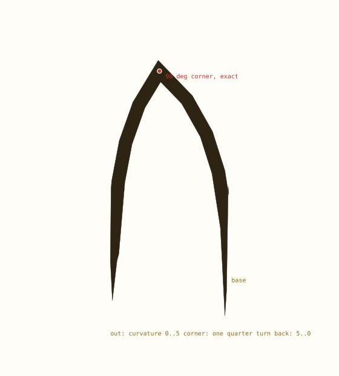
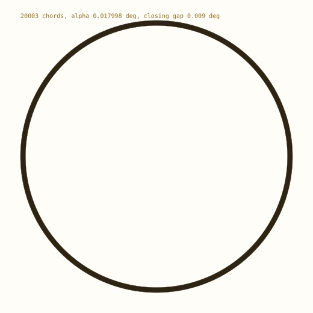

# Extremes: the hybrid, a 90 degree corner, and the angles

The float hybrid keeps the plan exact and draws in doubles. This document pushes it: a leaf with a sharp 90 degree corner and a relaxing return, the angles that the lattice can actually land on, and a 20,000-chord circle. Every figure is computed.

> Exactness is a property of the plan, not the pixels. The schedule, the closure and the corner are integers; the coordinates are doubles and are measured, not asserted.


## 1. The rule

| stays exact | becomes float | measured |
| --- | --- | --- |
| turn schedule and total coefficient | coordinates | 3.6e-15 at 60 chords |
| closure and apsis (integer sums) | headings | 3.1e-13 deg at 10k chords |
| quarter-turn cusp (a swap) | rail offsets | 1.1e-12 heading norm at 20k |
| mirror through an axis (-x is exact) | build time | 0.03 s for 20k |

Why it works: the closure proof never touches a coordinate. What the page needs is fifteen digits; what the proof needs is integers. Splitting them is the whole hybrid.


## 2. A leaf with a 90 degree corner



*A leaf edge climbing to 45 degrees, one exact quarter-turn cusp at the tip, and a return whose curvature relaxes 5..0.*

```text
chords        12
triangle      39-760-761
tip heading   44.06 deg (15 turns)
corner        [1] quarter turns = 90 deg, exact
return        turns 5,4,3,2,1,0 -- curvature relaxes
peak heading  88.13 deg (the return adds 15 turns)
final heading -91.87 deg (folded)
width         1/12, taper 2
```

The corner is the test. It is a component swap, not an angle, so it is exact even in the float chain: `(x, y)` becomes `(-y, x)`, which changes no digit. The miter rail then draws the point at the corner for free -- the rail intersection is the leaf's tip. A 90 degree corner is therefore the one angle this framework can hit with no residual at all.

The return is the other half of the test: its turn magnitudes fall 5..0, so the curvature relaxes to zero and the edge straightens. That is a leaf's back edge, and it costs nothing -- the schedule is still integers, and the sign of the curvature does not change through the return -- only its size.


## 3. Thirty, forty-five, ninety: what the lattice gives

The unit of this framework is the triangle angle, not the degree. `for_angle(3)` returns a triangle just under three degrees, so the angles you can hit exactly are its integer multiples -- and 3 itself is not available: `tan 30` is irrational and `tan 45` is 1, which no integer triple can have. So 30 and 45 are lattice approximations; 90 is exact only as a cusp.

| asked | schedule | achieved | error | kind |
| --- | --- | --- | --- | --- |
| 30 deg | 11 chords, flat | 29.38 deg | 0.62 deg | lattice |
| 45 deg | 16 chords, flat | 44.06 deg | 0.94 deg | lattice |
| 90 deg | 32 chords, flat | 91.07 deg | 1.07 deg | lattice |
| 90 deg | 1 chord + cusp | 90.00 deg | 0.00 deg | exact swap |

With alpha = 2.9376 deg, the nearest peaks are within one chord turn of the request -- which is all a chain can promise, because the peak is a sum of whole turns. The practical rule: pick the triple first, then ask for angles that are integer multiples of its angle; use a cusp for 90, 180 and 270.


## 4. Scale, and where the hybrid stops



*A 20,003-chord circle in floats, offset into a ribbon. The closing gap is the lattice, not the arithmetic.*

```text
chords        20003
triangle      6367-20269344-20269345
build         0.027 s
closing gap   0.009 deg  (360 is not a multiple of alpha)
heading norm  1.1e-12 off one
exact at 60   3.6e-15 from the exact chain
```

A closed lobe of 10,000 chords takes 0.018 s and ends 3.1e-13 deg from east, with its plan coefficient exactly zero. That is the ceiling lifted: ten thousand chords were minutes-to-never exact, and are now milliseconds. The residual is the float heading walking off the unit circle by about one ulp per turn.

What the hybrid does not fix: the rail is no longer exact (it normalizes with `hypot`), a closure is a plan fact rather than a coordinate fact, and a mirrored float chain is exact only because negation is exact. Branching still shares the stored float pair, so a fork meets bit-for-bit -- that survived without change.


## 5. Verdict on the extremes

| test | result |
| --- | --- |
| 90 degree corner, exact | pass -- swap, no residual |
| relaxing return | pass -- integer schedule |
| 30 / 45 by accumulation | within one chord turn, not exact |
| 90 by accumulation | within one chord turn; use a cusp |
| 20k chords, float | 0.03 s, plan exact, ink ~1e-13 |
| rails at 20k | works, exactness traded for speed |
| exact path small chains | unchanged, still bit-for-bit |

So the framework takes the extremes without changing its story: the plan is exact, the ink is close, and the corner is the one place where both are true at once.


## Reproduce

```text
cd pythagorean-spiral
../.venv/bin/python scripts/extremes.py
../.venv/bin/python -m unittest discover -s tests -t .
```
