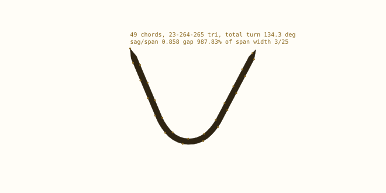
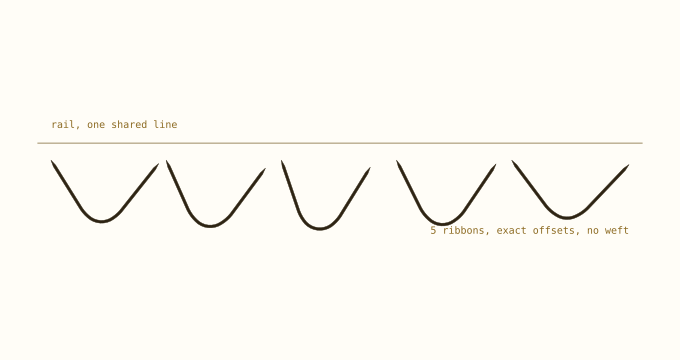
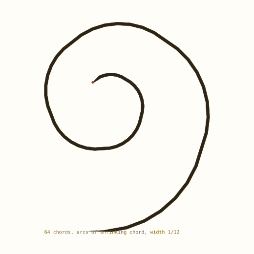
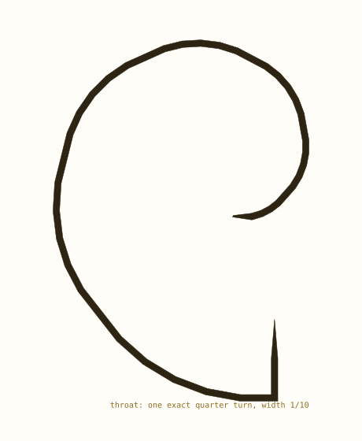
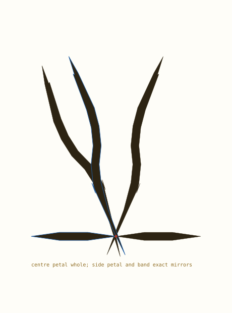

# Six studies on the spine framework

How much can hang off a chain of exact Pythagorean turns? Six named objects, each drawn as a filled ribbon and each leaning on a different part of the machinery: a curvature profile, repetition, a shrinking radius, a throat, branches, and an exact mirror.

> The names are targets, not claims. A catenary is a cosh, a volute is a logarithmic spiral, and neither is rational. What is exact is the plan: every anchor, every rail, every join, every mirror.

| study | leans on | verdict |
| --- | --- | --- |
| catenary | one curvature profile | close, measured |
| drapery | repetition, rails in parallel | close, no weft |
| Corinthian volute | arcs of shrinking chord | shape holds, seams step |
| violin scroll | a throat and a volute | shape holds, no pegbox |
| acanthus | `fork` at stored nodes | ribbon leaf, no serration |
| fleur-de-lis | `fork` plus exact mirror | filled, no terminals |


## 1. Rails, and why they are exact

A rail is a miter offset. The normal of a chord is its heading turned one quarter turn, which is a swap of two rationals; each chord is shifted by half the width; adjacent shifted chord lines are intersected. The intersection of two rational lines is rational. So the rail is a rational point at an exact distance from the exact chord, and the width is part of the proof rather than a stroke chosen by eye.

```text
spine node        exact rational point
normal            heading turned a quarter turn (a swap)
rail corner       intersection of two rational lines
taper             width multiplied by a rational ramp
failure           width larger than the inside radius: the rail folds
```

`ribbon.rail` and `ribbon.outline` take any chain -- including a composite of arcs with different chord lengths -- and recover the exact headings from the points themselves, because every chord length in a chain is rational. `taper=n` ramps the width to zero over n chords at each end, which is what turns a cut end into a leaf tip. The limit is the obvious one: inside a turn tighter than the half-width the rail crosses itself, and the module reports nothing -- the drawing shows it.


## 2. A simulated catenary



*A catenary as one chain of sech^2 turns, offset into a ribbon, rotated onto the page.*

The catenary's curvature is `1/(a cosh^2)`, largest at the low point. The chain cannot hold a cosh, so it holds the profile: integer turns following `sech^2`, scaled so the total turn equals the reference. That fixes the supports' angle, and leaves the sag to fall where it may.

```text
chords        49
triangle      23-264-265
total turn    134.34 deg
sag/span      0.858   (true catenary, same span)
worst gap     987.83% of the span
width         3/25, tapered over 2 chords
```

The honest sentence: it hangs like a catenary to about a percent of its span, and it is not one. The shape is a discrete curvature profile; a real catenary is a transcendental curve. On a 200 mm page the gap is under 2 mm at this aspect, the same order as the chord.


## 3. Drapery



*Five catenary ribbons hung from one rail; each keeps its own span, sag and node count.*

Repetition is free and exact: every chain is its own `Spiral`, its own offset, and the supports sit on one line. What the drawing cannot yet do is a fold, because a fold is a surface and this is a set of ribbons. It is a warp without a weft -- but the ribbons are real widths now, not hairlines, and five of them are five exact offsets.

The drape also shows where a `Bundle` belongs: five ribbons that must not touch are a bundle, and `clearance.py` already measures that in the main package. The spike does not import it yet -- one of the promotion-gate items.


## 4. A Corinthian volute



*A volute as a ribbon: eight quarter-arcs, each chord 13/16 of the last, joined on exact nodes.*

This is the first study that forced a change of construction. A volute tightens: the turn per chord grows as the radius shrinks, and with one fixed chord the last turns alias into a blade. So the chord itself shrinks -- one `Spiral` per quarter turn, each starting on the previous final node with the previous heading, `design.joined` proving the attachment by equality rather than by tolerance.

```text
arcs          8 quarter turns
chords        64
triangle      11-60-61
chord shrink  13/16 per quarter
seams         G1 exactly, curvature steps at each seam
width         1/12, tapered at the outer end
```

The step at a seam is the volute's own construction -- classical volutes are drawn as arcs with shifting centres -- but it is worth saying plainly: the join is G1, not G2. A smooth seam needs a chord schedule that interpolates the radius, which is a different builder.


## 5. A violin scroll



*The same volute machinery with a throat: two straight neck chords, one exact quarter turn, then the scroll.*

The scroll is the volute plus two things the framework does well: a straight run, and a right-angle cusp that is exact because a quarter turn is a swap, not an angle. The throat is where a real scroll carries the pegbox; here it is a bare corner, which is the boundary of the study -- the framework supplies the curve, not the instrument.


## 6. An acanthus


*A spine with paired lobes; every lobe is a `fork` on a stored node, drawn as a tapered ribbon.*

This is the study the `fork` API was built for. Each lobe leaves the spine on the identical tangent with opposite curvature, so the attachment is exact: no fitted junction, no gap to hide. The lobes alternate side by the sign of the turn, which is a property of the rotation group rather than a drawing choice. With rails they are leaves rather than veins.

```text
spine chords  8
forks         7
triangle      29-420-421
attachment    exact point, exact heading
tips          taper 2, width 1/7
```

Still missing: serration depth and a central rib. Both are widths and terminals over this skeleton, not changes to it -- the leaf is now a filled shape, and its veins are exact.


## 7. A fleur-de-lis



*Three lobed petals and a band; the centre petal is whole, the side petal and band are exact mirrors.*

The fleur is the cleanest test of exactness, because symmetry is where drawing errors show. The centre petal is a lobe whose apsis lands exactly on north, so it is symmetric without being mirrored; the side petal and the band are reflected through the vertical axis, point for point. The two halves cannot disagree: there is no fitting step to disagree in. Rails then make it a silhouette -- the apsis miter is the petal's point.

```text
petals        3 lobed ribbons
band          one tapered ribbon, exact mirror
mirror        exact, through the vertical axis
tips          the apsis itself, plus taper at the base
width         1/6, tapered at the base
```

What it is not is a finished fleur: the tips need real terminals (W02's taper, measured at 17-18 per cent), the band wants to be a filled member, and the whole needs a `Bundle` to declare what may touch. Those are the next layer, and they now have an exact, filled skeleton to sit on.


## 8. What hangs off, and what does not

| capability | evidence here | status |
| --- | --- | --- |
| exact anchors | all six figures | proved |
| exact G1 joins | volute, scroll, acanthus | proved |
| exact mirror | fleur | proved |
| branch at a node | acanthus, fleur | proved |
| miter rails and width | every figure | proved |
| tapered terminals | petals, lobes, ribbon ends | proved |
| a transcendental curve | catenary | simulated, ~1% |
| serration and rib | acanthus | absent |
| curvature-continuous seams | volute | G1 only |
| folds and weft | drapery | absent |
| past ~300 chords in one chain | any study at finer chord | blocked by exact cost |

That is the answer to how much can hang off it. The **plan** -- where every curve starts, turns, joins, ends, and how wide it is -- is exact and load-bearing. The **surface** -- folds, serrations, fills, texture -- is not in the framework and should not be: it belongs to `Piece`, `Bundle`, `Section` and the terminals. The one genuine architectural limit is scale: exact coordinates cost digits, and a single chain past a few hundred chords is refused. The float hybrid is the next action for that reason.

Each study is about forty lines of builder in `scripts/gallery.py`, and every figure is regenerated from the code by running it. None of them is tuned by eye.


## Reproduce

```text
cd pythagorean-spiral
../.venv/bin/python scripts/gallery.py
../.venv/bin/python -m unittest discover -s tests -t .
```
